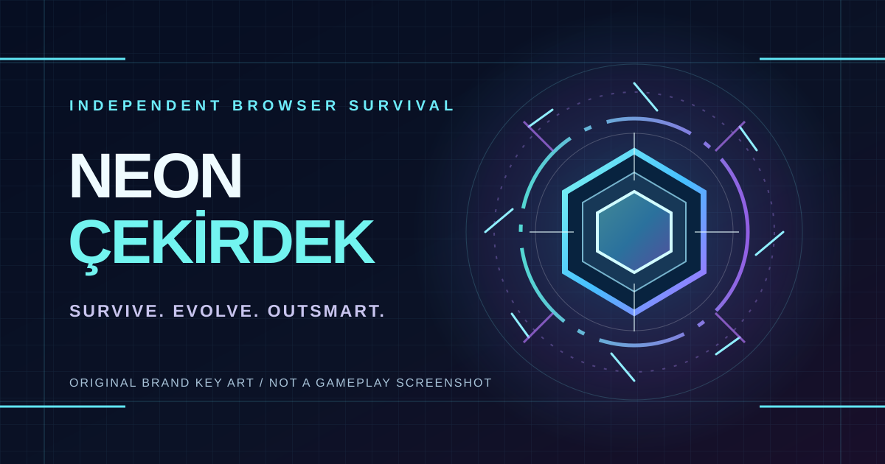

<p align="center">
  
</p>

# NEON ÇEKİRDEK · Survive. Evolve. Outsmart.

**An independently developed, playable browser arena-survival game** built with Canvas 2D and vanilla JavaScript. Survive tactical enemy formations, evolve your modules, use the arena itself as a weapon, and adapt your build as combat pressure rises.

[](https://github.com/bkrbzdgn40/neon-cekirdek-survival/actions/workflows/neon-smoke.yml)
**[Showcase source](showcase.html)** · **[Media & factsheet](docs/PRESSKIT.md)** · **[Real gameplay capture process](docs/M5.28-gameplay-evidence.md)** · **[Engineering evidence](#engineering-and-verification)** · **[Türkçe](#türkçe)**

> **No public hosted demo is confirmed yet.** This repository contains the playable build (`index.html`) and a new professional showcase (`showcase.html`). Use a local static server as described below. GitHub Pages activation is documented in [Publishing](docs/PUBLISHING.md); a source-file link on GitHub is not a live game.

## What makes the game distinct

- **Tactical encounters:** Combat Director scenarios, coordinated enemy formations, four boss archetypes and optional adaptive normal-spawn tempo.
- **Build expression:** Three starting chassis, modular upgrades, evolutions, synergies, counter-skills and independently tracked progression.
- **Arena as an opponent and tool:** Rotating Foundry, Garden and Rift chapters, specific arena operations, volatile reactors that can chain-explode, and graviton pylons that slow regular enemies.
- **Readable combat:** Procedural neon effects, combat HUD hierarchy, telegraphed attacks and graphic-quality presets.
- **Offline-friendly architecture:** No required login, backend, account API or build step. Fonts and icon assets are stored locally in the repository.

**What this does not claim:** A production release, Steam listing, proven 60 FPS on all devices, autonomous combat AI trained on cloud data, or performance validated through long manual sessions. The optional player-learning model runs in **shadow mode**; it does not control spawns or rewards.

## Play locally

From a clone/download of this repository:

```sh
python -m http.server 8000
```

Open **http://localhost:8000/showcase.html** for the presentation or **http://localhost:8000/index.html** to play directly. The game can also open via `index.html` as a static file; a local HTTP server is generally more reliable.

**Controls:** Mouse/touch movement, **Space** for dash, **E** for EMP Nova, **C** for Prism Riposte, **Q** for Bastion (when available), **P/Escape** to pause. Exact bindings and on-screen cues are visible in-game.

### Modes and persistence

| Query | Behavior |
|---|---|
| No query or `?tempo=classic` | Default classic tempo |
| `?tempo=adaptive` | Optional local adaptive normal-spawn pacing |
| `?learn=on` | Observation-only shadow player learner |
| `?perf=1` | Opt-in performance diagnostics (desktop F3) |

Gold, meta progression, settings and optional learning/tempo comparison records are stored in browser `localStorage`. They are **not synced to the cloud**. The menu's JSON **YEDEK AL / YEDEK YÜKLE** feature exports and restores meta progression and graphics configuration; learning model and comparison records are not part of that backup.

## Engineering and verification

| Layer | Implementation / evidence |
|---|---|
| Game | [`index.html`](index.html), [`src/game.js`](src/game.js), [`src/game.css`](src/game.css), locally built [`src/utilities.css`](src/utilities.css) |
| Public-facing showcase | [`showcase.html`](showcase.html), [`src/showcase.css`](src/showcase.css), [`src/showcase.js`](src/showcase.js) |
| Logic regressions | [`tests/smoke.test.cjs`](tests/smoke.test.cjs) executed against actual game script in a VM DOM harness |
| Real browser regressions | [`tests/game.browser.spec.cjs`](tests/game.browser.spec.cjs), Chromium desktop and mobile viewports |
| PR/main CI | [Neon smoke](.github/workflows/neon-smoke.yml) |
| Additional browser load check | [Neon soak](.github/workflows/neon-soak.yml) |
| Manual real-device criteria | [Device QA protocol](docs/DEVICE_QA.md) |
| Architecture/change records | [`docs/`](docs/) |

```sh
node --test tests/smoke.test.cjs

# Optional local Chromium tests
npm install --no-save --no-package-lock @playwright/test@1.56.1
npx playwright install chromium
npx playwright test
```

**Verification boundary:** Passing CI establishes specific automated regression behavior, not visual snapshot approval, a universally stable FPS, or 30–60 minute real-device performance. See [Device QA](docs/DEVICE_QA.md). This remains an actively developed game, not a finished commercial product.

## For developers, reviewers and press

**[Public showcase](showcase.html)** · **[Fact sheet / press kit](docs/PRESSKIT.md)** · **[Brand key art (original SVG)](media/neon-core-cover.svg)** · **[How to publish a live demo](docs/PUBLISHING.md)**

The SVG is **original promotional brand art, not an in-game screenshot**. For authentic gameplay capture, launch `index.html` and record the actual Canvas. Do not represent the brand illustration as gameplay.

For technical discussion or editorial enquiries, use the repository's [GitHub Issues](https://github.com/bkrbzdgn40/neon-cekirdek-survival/issues). No dedicated press e-mail or external awards are claimed. The repository currently has **no declared public code license**, so do not assume it is licensed for reuse.

---

## Türkçe

**Neon Çekirdek: Hayatta Kal**, Canvas 2D ile geliştirilmiş, tarayıcıda oynanan bağımsız bir arena-survival oyunudur. Modüllerini geliştirirken yönlendirilen düşman formasyonlarına, farklı boss'lara, arena bölümlerine ve savaş alanındaki etkileşimli cihazlara karşı hayatta kalırsın.

**Öne çıkanlar:** Üç şasi; nadirlik/kademe, evrim ve sinerji sistemleri; Combat Director karşılaşmaları; Dökümhane, Bahçe ve Yarık; Prizma Karşılığı, EMP Nova, Atılım ve Bastion; zincir patlayan reaktörler ile düşman yavaşlatan Graviton direkleri.

**Oyunu çalıştırma:** Depoyu indir, kök dizinde `python -m http.server 8000` komutunu çalıştır ve `http://localhost:8000/index.html` adresine git. Yeni tanıtım sayfası `http://localhost:8000/showcase.html` adresindedir. Kurulum, API, veritabanı veya hesap gerekmez. Şimdilik doğrulanmış açık bir canlı demo adresi yoktur; yayın adımları [burada](docs/PUBLISHING.md).

**Geliştirici/incelemeci için:** [Oyun testleri](tests/) · [CI](.github/workflows/neon-smoke.yml) · [Gerçek cihaz QA sınırları](docs/DEVICE_QA.md) · [Basın kiti](docs/PRESSKIT.md) · [Geliştirme belgeleri](docs/).

**Kayıtlar:** Kalıcı ilerleme, altın ve ayarlar tarayıcıda saklanır. Menüdeki YEDEK AL / YEDEK YÜKLE JSON yedeğiyle taşınabilir. Oyuncu öğrenen model, açıkça etkinleştirilen gözlemsel/gölge moddur; spawn/ödül üzerinde karar vermez.

Geliştirme yol haritası [tarihsel bir belge](Neon_Cekirdek_Gelistirme_Yol_Haritasi.txt) niteliğindedir. Güncel özellikler için kaynak kod ve doğrulanmış `main` CI kullanılmalıdır. Proje bir ticari çıkış veya uzun süreli cihaz performans sertifikası olarak sunulmamaktadır.
